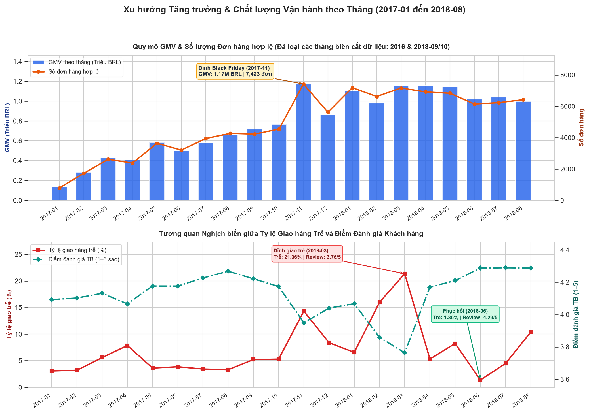
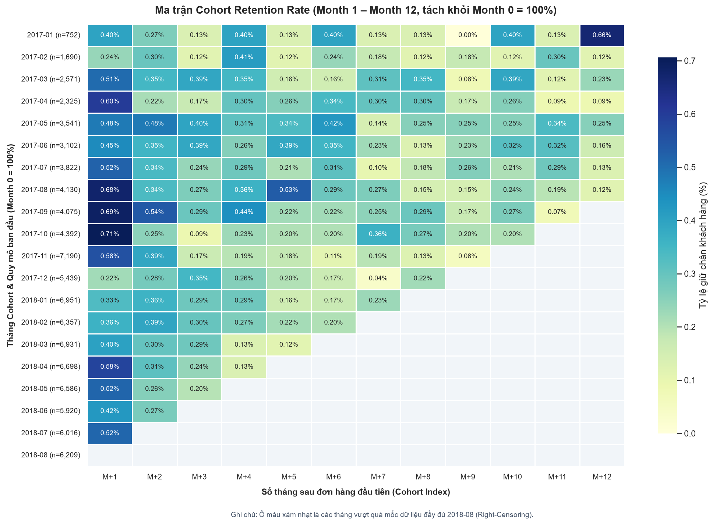

# Báo cáo Phân tích KPI Kinh doanh & Cohort Retention — Chương 4

- **Thời điểm tạo báo cáo:** 2026-11-24 10:53:21
- **Phạm vi dữ liệu:** Các đơn hàng hợp lệ (`order_status NOT IN ('canceled', 'unavailable')`) từ kho `olist.duckdb` (`dw.*`).

---

## 1. Tổng quan KPI Toàn kỳ

| Chỉ số KPI | Giá trị thực tế | Ghi chú nghiệp vụ |
| :--- | ---: | :--- |
| Tổng đơn hàng hợp lệ | **98,207** | Không tính đơn `canceled` và `unavailable` |
| Tổng khách hàng duy nhất (`customer_unique_id`) | **94,990** | Định danh con người thật |
| Khách mua lặp lại (≥ 2 đơn) | **2,888** (3.04%) | Phản ánh mức độ trung thành rất thấp |
| Tổng GMV (`payment_total`) | **15,739,137.01 BRL** | Tổng giá trị thanh toán gồm sản phẩm & vận chuyển |
| Doanh thu sản phẩm ròng (`items_price_total`) | **13,494,400.74 BRL** | Tổng tiền hàng trước phí ship |
| Giá trị đơn hàng trung bình (AOV) | **160.26 BRL** | `total_gmv / total_orders` |
| Thời gian giao hàng trung bình | **12.56 ngày** | Tính trên đơn `is_valid_delivered = TRUE` |
| Tỷ lệ giao hàng trễ hẹn | **8.11%** | So với `order_estimated_delivery_date` |
| Điểm đánh giá trung bình | **4.12 / 5.00** | Trên các đơn có đánh giá |
| Tỷ lệ đánh giá thấp (1–2 sao) | **13.87%** | Tỷ trọng nhóm rủi ro trải nghiệm xấu |

---

## 2. Xu hướng Tăng trưởng & Chất lượng Vận hành theo Tháng

> **Lưu ý phạm vi biểu đồ:** Các tháng biên `2016-09`, `2016-10`, `2016-12` và `2018-09` chỉ có 1–293 đơn do cắt đầu/cuối tập dữ liệu thu thập (*edge-period censoring*). Biểu đồ tập trung vào **20 tháng vận hành đầy đủ từ `2017-01` đến `2018-08`** để tránh làm méo đường xu hướng và tỷ lệ tăng trưởng MoM.

- **Đà tăng trưởng & Đỉnh Black Friday:** GMV tăng mạnh xuyên suốt năm 2017 và đạt đỉnh lịch sử vào **2017-11** với **1,172,639.23 BRL** (7,423 đơn hàng), phản ánh hiệu ứng khuyến mãi cuối năm.
- **Điểm nghẽn Logistics đầu năm 2018:** Tỷ lệ giao hàng trễ vọt lên đỉnh **21.36%** vào **2018-03** (từ mức 15.99% của `2018-02`), kéo điểm đánh giá trung bình rơi xuống đáy **3.76★**.
- **Phục hồi vận hành:** Từ `2018-04` đến `2018-08`, khi tỷ lệ giao trễ được kéo giảm về đáy **1.36%** ở **2018-06**, điểm đánh giá trung bình nhanh chóng hồi phục lên **4.29★** — cho thấy sự nhạy cảm rất rõ giữa tiến độ giao hàng và sự hài lòng.

---

## 3. Phân tích Ma trận Cohort Giữ chân Khách hàng

| Mốc tuổi Cohort | Tỷ lệ giữ chân trung bình (2017-01 – 2018-08) | Ghi chú |
| :--- | ---: | :--- |
| **Month 1 (M+1)** | **0.48%** | Cao nhất đạt 0.71% ở cohort `2017-10` |
| **Month 2 (M+2)** | **0.33%** | Giảm sâu sau tháng đầu |
| **Month 3 (M+3)** | **0.25%** | Duy trì quanh mức ~0.25% |
| **Month 6 (M+6)** | **0.26%** | Gần như không có nhịp quay lại tự nhiên |

**Phân tích bối cảnh kinh doanh tại sao Retention của Olist rất thấp (~0.2%–0.5%):**
1. **Mô hình sàn trung gian (Aggregator Marketplace):** Khách hàng tại Brazil mua qua nhiều kênh đối tác gắn nhãn Olist; trải nghiệm thương hiệu gắn với cửa hàng/sản phẩm hơn là nhận diện sàn Olist, nên thiếu động lực quay lại trực tiếp.
2. **Cơ cấu ngành hàng mua sắm thưa (Low-frequency Categories):** Các ngành chủ lực như đồng hồ/quà tặng, đồ nội thất/gia dụng (`bed_bath_table`), điện tử/phụ kiện có chu kỳ thay mới dài, khác với hàng tiêu dùng nhanh (FMCG).
3. **Không có cơ chế giữ chân sau bán (CRM/Loyalty):** Thiếu chương trình tích điểm, voucher tái mua trong 30 ngày đầu (*M+1*) và bị ảnh hưởng bởi các đợt giao trễ (8.11% toàn kỳ).
4. **Gợi ý hành động:** Tập trung chiến dịch tái kích hoạt (*Win-back / Voucher*) vào cửa sổ vàng **15–45 ngày sau đơn đầu (M+1)** cho nhóm ngành hàng có tần suất lặp tự nhiên cao (như `health_beauty`, `pet_shop`) và ưu tiên cải thiện đúng hạn cho đơn đầu tiên.

---

## 4. Hiệu suất theo Ngành hàng & theo Bang

### 4.1 Top 10 Ngành hàng có Doanh thu Sản phẩm cao nhất

| Hạng | Ngành hàng (EN) | Số đơn | Số sản phẩm | Doanh thu SP (BRL) | Giá TB (BRL) | Tỷ lệ giao trễ (%) | Điểm Review TB | Tỷ lệ Review thấp (%) |
| ---: | :--- | ---: | ---: | ---: | ---: | ---: | ---: | ---: |
| 1 | `health_beauty` | 8,800 | 9,634 | 1,255,695.13 | 130.34 | 8.96% | 4.19 | 12.47% |
| 2 | `watches_gifts` | 5,604 | 5,970 | 1,198,185.21 | 200.70 | 8.52% | 4.07 | 14.95% |
| 3 | `bed_bath_table` | 9,399 | 11,097 | 1,035,964.06 | 93.36 | 8.75% | 3.97 | 16.66% |
| 4 | `sports_leisure` | 7,673 | 8,590 | 979,740.92 | 114.06 | 7.76% | 4.18 | 12.57% |
| 5 | `computers_accessories` | 6,654 | 7,781 | 904,322.02 | 116.22 | 7.70% | 4.04 | 15.73% |
| 6 | `furniture_decor` | 6,425 | 8,298 | 727,465.05 | 87.67 | 8.48% | 4.02 | 16.39% |
| 7 | `housewares` | 5,847 | 6,915 | 626,825.80 | 90.65 | 6.95% | 4.16 | 12.76% |
| 8 | `cool_stuff` | 3,616 | 3,779 | 620,770.49 | 164.27 | 6.83% | 4.18 | 12.21% |
| 9 | `auto` | 3,872 | 4,204 | 586,585.73 | 139.53 | 8.61% | 4.10 | 14.10% |
| 10 | `garden_tools` | 3,505 | 4,328 | 481,009.94 | 111.14 | 7.95% | 4.14 | 13.18% |

### 4.2 Top 5 Bang có GMV lớn nhất

| Bang | Số đơn | Khách duy nhất | Tổng GMV (BRL) | AOV (BRL) | Giao TB (Ngày) | Giao Median (Ngày) | Tỷ lệ trễ (%) | Review TB |
| :--- | ---: | ---: | ---: | ---: | ---: | ---: | ---: | ---: |
| **SP** | 41,127 | 39,749 | 5,878,935.99 | 142.95 | 8.76 | 7.21 | 5.89% | 4.21 |
| **RJ** | 12,698 | 12,242 | 2,115,994.28 | 166.64 | 15.31 | 12.04 | 13.47% | 3.90 |
| **MG** | 11,496 | 11,134 | 1,843,460.37 | 160.36 | 12.01 | 10.31 | 5.61% | 4.16 |
| **RS** | 5,417 | 5,234 | 877,803.80 | 162.05 | 15.30 | 13.18 | 7.15% | 4.15 |
| **PR** | 4,983 | 4,825 | 794,653.20 | 159.47 | 11.99 | 10.43 | 5.00% | 4.21 |

### 4.3 Top 5 Bang giao hàng lâu nhất & Top 5 Bang có điểm Review thấp nhất

| Nhóm | Bang | Số đơn | Giao TB (Ngày) | Giao Median (Ngày) | Tỷ lệ trễ (%) | Điểm Review TB | Tỷ lệ Review thấp (%) |
| :--- | :--- | ---: | ---: | ---: | ---: | ---: | ---: |
| Giao lâu nhất | **RR** | 45 | 29.39 | 25.01 | 12.20% | 3.64 | 22.22% |
| Giao lâu nhất | **AP** | 68 | 27.19 | 24.35 | 4.48% | 4.19 | 7.46% |
| Giao lâu nhất | **AM** | 147 | 26.43 | 25.88 | 4.14% | 4.22 | 13.79% |
| Giao lâu nhất | **AL** | 411 | 24.54 | 22.33 | 23.93% | 3.76 | 23.77% |
| Giao lâu nhất | **PA** | 969 | 23.77 | 21.08 | 12.37% | 3.86 | 19.25% |
| Review thấp nhất | **RR** | 45 | 29.39 | 25.01 | 12.20% | 3.64 | 22.22% |
| Review thấp nhất | **AL** | 411 | 24.54 | 22.33 | 23.93% | 3.76 | 23.77% |
| Review thấp nhất | **MA** | 736 | 21.57 | 19.19 | 19.67% | 3.78 | 21.34% |
| Review thấp nhất | **SE** | 345 | 21.52 | 18.01 | 15.22% | 3.84 | 20.93% |
| Review thấp nhất | **PA** | 969 | 23.77 | 21.08 | 12.37% | 3.86 | 19.25% |

---

## 5. Giả thuyết chuyển tiếp sang Chương 5 (Chẩn đoán Thống kê)

Từ các mẫu hình mô tả ở Chương 4 (như bang `RJ` giao TB 15.31 ngày / trễ 13.47% / review 3.90★ so với `SP` giao 8.76 ngày / trễ 5.89% / review 4.21★, và đỉnh giao trễ tháng 2018-03 làm review tụt xuống 3.76★), ta đề xuất **3 giả thuyết kiểm định thống kê** cho Chương 5:

1. **Giả thuyết 1 (Khác biệt địa lý — Levene + One-Way ANOVA + Tukey HSD):** Thời gian giao hàng (`delivery_days`) và điểm đánh giá (`review_score`) có sự khác biệt có ý nghĩa thống kê giữa các bang/vùng địa lý hay không (đặc biệt giữa nhóm bang lõi Đông Nam như `SP` với `RJ` và các bang xa miền Bắc/Đông Bắc như `RR`, `AP`, `AL`, `MA`)?
2. **Giả thuyết 2 (Tác nhân gây đánh giá thấp & hủy đơn — Chi-square Test of Independence):** Việc giao hàng trễ (`is_late_delivery`), ngành hàng sản phẩm (`product_category_en`) hoặc phương thức thanh toán (`primary_payment_type`) có mối liên hệ độc lập/phụ thuộc có ý nghĩa thống kê với tỷ lệ đánh giá xấu (`is_low_review`) và trạng thái hủy đơn (`canceled`) hay không?
3. **Giả thuyết 3 (Cường độ tác động của trễ hẹn lên điểm đánh giá — Mann-Whitney U / Independent Test):** Chênh lệch thời gian giao hàng và số ngày trễ hẹn (`delivery_delay_days`) giữa nhóm đơn hàng bị 1–2 sao và nhóm 4–5 sao có khác biệt đáng kể về mặt thống kê hay không, nhằm định lượng ngưỡng SLA giao hàng mục tiêu?
