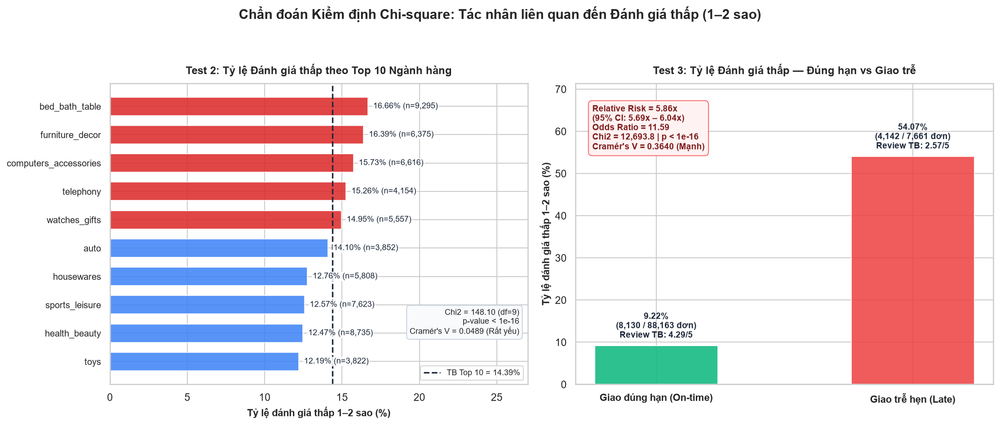
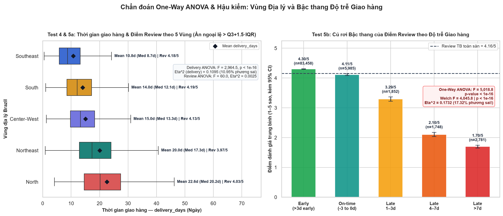

# Báo cáo Phân tích Chẩn đoán bằng Kiểm định Thống kê — Chương 5

- **Thời điểm chạy kiểm định:** 2026-11-24 19:44:38
- **Nguồn dữ liệu:** Kho Star Schema `olist.duckdb` (`dw.fact_orders`, `dw.fact_order_items`, `dw.dim_products` — chế độ `read_only=True`).
- **Mức ý nghĩa thống kê chuẩn:** $\alpha = 0.05$ (kết hợp bắt buộc với **Độ lớn tác động — Effect Size** để tránh bẫy cỡ mẫu lớn $N \approx 96,000$).

---

## 1. Bảng Tóm tắt Điều hành (Executive Summary)

| Mã | Bài kiểm định & Giả thuyết $H_0$ | Phương pháp chính | Giá trị thống kê | `p-value` | Effect Size | Kết luận ($\alpha=0.05$) |
| :--- | :--- | :--- | ---: | ---: | :--- | :--- |
| **Test 1** | $H_0$: Phương thức thanh toán độc lập với hủy đơn | Chi-square ($df=3$) | $\chi^2 = 153.06$ | `< 1e-16` | Cramér's $V = 0.0392$ (Rất yếu) | **Bác bỏ $H_0$** (Ý nghĩa thực tiễn nhỏ) |
| **Test 2** | $H_0$: Top 10 ngành hàng độc lập với tỷ lệ review 1–2 sao | Chi-square ($df=9$) | $\chi^2 = 148.10$ | `< 1e-16` | Cramér's $V = 0.0489$ (Rất yếu) | **Bác bỏ $H_0$** (Khác biệt nhẹ theo ngành) |
| **Test 3** | $H_0$: Giao hàng trễ độc lập với đánh giá thấp 1–2 sao | Chi-square ($df=1$) | $\chi^2 = 12,693.81$ | `< 1e-16` | Cramér's $V = 0.3640$, **RR = 5.86x** | **Bác bỏ $H_0$ (Tác nhân mạnh nhất)** |
| **Test 4** | $H_0$: Trung bình `delivery_days` bằng nhau ở 5 vùng Brazil | One-Way ANOVA (+ Welch/KW) | $F = 2,964.55$ | `< 1e-16` | $\eta^2 = 0.1095$ (10.95%) | **Bác bỏ $H_0$** (Tác động vừa–lớn) |
| **Test 5a** | $H_0$: Trung bình `review_score` bằng nhau ở 5 vùng Brazil | One-Way ANOVA (+ Welch/KW) | $F = 59.96$ | `< 1e-16` | $\eta^2 = 0.0025$ (0.25%) | **Bác bỏ $H_0$** (Tác động trực tiếp rất nhỏ) |
| **Test 5b** | $H_0$: Trung bình `review_score` bằng nhau ở 5 nấc độ trễ | One-Way ANOVA (+ Welch/KW) | $F = 5,018.83$ | `< 1e-16` | $\eta^2 = 0.1732$ (**17.32%**) | **Bác bỏ $H_0$ (Giải thích mạnh nhất)** |

---

## 2. Chi tiết Nhóm A — Kiểm định Độc lập Chi-square & Độ lớn Tác động

### 2.1 Test 1: Phương thức thanh toán chính vs Tỷ lệ Hủy / Không khả dụng

- **Lưu ý tiền xử lý mẫu:** Đã lọc bỏ dòng `primary_payment_type IS NULL` (1 dòng) và nhóm quá nhỏ `not_defined` (n=3) (`< 10` quan sát, cả 3 đơn đều hủy do chưa xác định thanh toán) nhằm đảm bảo điều kiện tần số kỳ vọng tối thiểu của kiểm định Chi-square ($\min(E_{ij}) = 18.90 \ge 5$).
- **Kết quả:** $\chi^2 = 153.06$, $df = 3$, $p = < 1e-16$, **Cramér's $V = 0.0392$**.

| Phương thức thanh toán | Tổng số đơn | Số đơn hủy / không khả dụng | Tỷ lệ hủy (%) |
| :--- | ---: | ---: | ---: |
| `voucher` | 3,151 | 114 | 3.62% |
| `boleto` | 19,784 | 245 | 1.24% |
| `credit_card` | 74,975 | 859 | 1.15% |
| `debit_card` | 1,527 | 13 | 0.85% |

- **Diễn giải nghiệp vụ:** Đơn thanh toán bằng `voucher` có tỷ lệ hủy cao gấp ~3 lần `credit_card` (3.62% vs 1.15%), dẫn đến $p < 0.0001$. Tuy nhiên **Cramér's $V = 0.0392$** rất nhỏ (< 0.10), cho thấy phương thức thanh toán không phải rào cản gây hủy đơn trên diện rộng.

### 2.2 Test 2: Top 10 Ngành hàng lớn nhất vs Tỷ lệ Đánh giá thấp (1–2 sao)

- **Đơn vị phân tích:** Khử trùng ở cấp `(order_id, product_category_en)` trên các đơn hợp lệ có đánh giá ($N = 61,837$, $\min(E_{ij}) = 549.90 \ge 5$).
- **Kết quả:** $\chi^2 = 148.10$, $df = 9$, $p = < 1e-16$, **Cramér's $V = 0.0489$**.

| Ngành hàng (EN) | Số đơn có review | Số đơn 1–2 sao | Tỷ lệ đánh giá thấp (%) | Điểm Review TB |
| :--- | ---: | ---: | ---: | ---: |
| `bed_bath_table` | 9,295 | 1,549 | 16.66% | 3.97 |
| `furniture_decor` | 6,375 | 1,045 | 16.39% | 4.02 |
| `computers_accessories` | 6,616 | 1,041 | 15.73% | 4.04 |
| `telephony` | 4,154 | 634 | 15.26% | 4.01 |
| `watches_gifts` | 5,557 | 831 | 14.95% | 4.07 |
| `auto` | 3,852 | 543 | 14.10% | 4.10 |
| `housewares` | 5,808 | 741 | 12.76% | 4.16 |
| `sports_leisure` | 7,623 | 958 | 12.57% | 4.18 |
| `health_beauty` | 8,735 | 1,089 | 12.47% | 4.19 |
| `toys` | 3,822 | 466 | 12.19% | 4.21 |

### 2.3 Test 3: Giao hàng trễ (`is_late_delivery`) vs Đánh giá thấp (`is_low_review`)

- **Kết quả:** $\chi^2 = 12,693.81$, $df = 1$, $p < 1e-16$, **Cramér's $V = 0.3640$**.
- **Lượng hóa rủi ro kinh doanh:**
  - Tỷ lệ đánh giá 1–2 sao khi giao đúng hạn: **9.22%** (8,130 / 88,163 đơn, Review TB = 4.29/5).
  - Tỷ lệ đánh giá 1–2 sao khi giao trễ: **54.07%** (4,142 / 7,661 đơn, Review TB = 2.57/5).
  - **Relative Risk (Tỷ số nguy cơ) = 5.86 lần** (95% CI: `[5.69x, 6.04x]`) và **Odds Ratio = 11.59** $\rightarrow$ Một đơn hàng giao trễ có xác suất nhận 1–2 sao cao gấp **5.86 lần** so với đơn giao đúng hạn!

---

## 3. Chi tiết Nhóm B — Levene, One-Way ANOVA, Kiểm định Bền vững & Hậu kiểm Tukey HSD

> **Tính minh bạch phương pháp luận:** Với dữ liệu thương mại điện tử cỡ lớn ($N \approx 96,000$), tiền kiểm định **Levene** cho thấy phương sai giữa các nhóm không đồng nhất ($p < 0.05$), đồng thời `delivery_days` lệch phải còn `review_score` rời rạc 1–5. Do đó, bên cạnh **One-Way ANOVA** truyền thống, báo cáo đối chiếu song song với **Welch's ANOVA** (không yêu cầu phương sai đồng nhất) và **Kruskal-Wallis H-test** (phi tham số). Kết quả cả 3 phép kiểm định đều thống nhất tuyệt đối!

### 3.1 Test 4: Thời gian giao hàng (`delivery_days`) theo 5 Vùng địa lý Brazil

- **Levene's Test:** $W = 282.46$, $p < 1e-16$ (Phương sai khác biệt có ý nghĩa thống kê giữa các vùng).
- **One-Way ANOVA:** $F(4, 96,465) = 2,964.55$, $p < 1e-16$, **$\eta^2 = 0.1095$** (Vùng địa lý giải thích **10.95%** phương sai thời gian giao hàng).
- **Đối chiếu bền vững:** Welch's ANOVA $F = 1,996.39$ ($p < 1e-16$) | Kruskal-Wallis $H = 14,809.84$ ($p < 1e-16$).

| Vùng địa lý | Số đơn ($n$) | Mean (Ngày) | Median (Ngày) | Std (Ngày) | 95% CI của Mean | Tỷ lệ giao trễ (%) |
| :--- | ---: | ---: | ---: | ---: | :--- | ---: |
| **Southeast** | 66,193 | 10.75 | 8.71 | 8.50 | [10.69, 10.82] | 7.45% |
| **South** | 13,813 | 14.03 | 12.12 | 8.44 | [13.89, 14.17] | 7.05% |
| **Center-West** | 5,624 | 15.02 | 13.28 | 8.39 | [14.80, 15.24] | 7.97% |
| **Northeast** | 9,044 | 20.01 | 17.32 | 12.25 | [19.75, 20.26] | 14.33% |
| **North** | 1,796 | 22.59 | 20.16 | 13.09 | [21.99, 23.20] | 9.80% |

**Hậu kiểm Tukey HSD — Test 4 (`delivery_days` giữa 10 cặp vùng):**

| Nhóm 1 (`group1`) | Nhóm 2 (`group2`) | Chênh lệch TB (`meandiff`) | `p-adj` | 95% CI Lower | 95% CI Upper | Bác bỏ $H_0$ (`reject`) |
| :--- | :--- | ---: | ---: | ---: | ---: | :---: |
| `Center-West` | `North` | +7.5745 | < 0.0001 | +6.9085 | +8.2406 | **Có** |
| `Center-West` | `Northeast` | +4.9872 | < 0.0001 | +4.5699 | +5.4045 | **Có** |
| `Center-West` | `South` | -0.9854 | < 0.0001 | -1.3741 | -0.5967 | **Có** |
| `Center-West` | `Southeast` | -4.2659 | < 0.0001 | -4.6072 | -3.9245 | **Có** |
| `North` | `Northeast` | -2.5873 | < 0.0001 | -3.2221 | -1.9525 | **Có** |
| `North` | `South` | -8.5600 | < 0.0001 | -9.1764 | -7.9436 | **Có** |
| `North` | `Southeast` | -11.8404 | < 0.0001 | -12.4281 | -11.2527 | **Có** |
| `Northeast` | `South` | -5.9727 | < 0.0001 | -6.3051 | -5.6403 | **Có** |
| `Northeast` | `Southeast` | -9.2531 | < 0.0001 | -9.5286 | -8.9776 | **Có** |
| `South` | `Southeast` | -3.2804 | < 0.0001 | -3.5103 | -3.0506 | **Có** |

### 3.2 Test 5a: Điểm đánh giá (`review_score`) theo 5 Vùng địa lý Brazil

- **Levene's Test:** $W = 59.96$, $p < 1e-16$.
- **One-Way ANOVA:** $F(4, 95,819) = 59.96$, $p < 1e-16$, **$\eta^2 = 0.0025$** (0.25%).
- **Đối chiếu bền vững:** Welch's ANOVA $F = 52.55$ ($p < 1e-16$) | Kruskal-Wallis $H = 243.48$ ($p < 1e-16$).
- **Nhận xét quan trọng:** Dù $p < 0.0001$, $\eta^2$ của vùng địa lý lên `review_score` chỉ đạt **0.25%** (rất nhỏ!). Khách hàng miền Bắc (`North`) chờ trung bình 22.59 ngày nhưng nếu giao đúng ngày hẹn dự kiến thì họ vẫn chấm điểm khá cao (4.03/5); chỉ những vùng vừa xa vừa bị **trễ so với ngày hẹn** (như `Northeast`: trễ 14.33%) mới tụt điểm mạnh.

**Hậu kiểm Tukey HSD — Test 5a (`review_score` giữa 10 cặp vùng):**

| Nhóm 1 (`group1`) | Nhóm 2 (`group2`) | Chênh lệch TB (`meandiff`) | `p-adj` | 95% CI Lower | 95% CI Upper | Bác bỏ $H_0$ (`reject`) |
| :--- | :--- | ---: | ---: | ---: | ---: | :---: |
| `Center-West` | `North` | -0.0971 | 0.0434 | -0.1923 | -0.0018 | **Có** |
| `Center-West` | `Northeast` | -0.1583 | < 0.0001 | -0.2179 | -0.0987 | **Có** |
| `Center-West` | `South` | +0.0627 | 0.0175 | +0.0072 | +0.1183 | **Có** |
| `Center-West` | `Southeast` | +0.0510 | 0.0351 | +0.0022 | +0.0997 | **Có** |
| `North` | `Northeast` | -0.0612 | 0.3513 | -0.1521 | +0.0296 | Không |
| `North` | `South` | +0.1598 | < 0.0001 | +0.0716 | +0.2480 | **Có** |
| `North` | `Southeast` | +0.1480 | < 0.0001 | +0.0639 | +0.2321 | **Có** |
| `Northeast` | `South` | +0.2210 | < 0.0001 | +0.1735 | +0.2685 | **Có** |
| `Northeast` | `Southeast` | +0.2093 | < 0.0001 | +0.1699 | +0.2487 | **Có** |
| `South` | `Southeast` | -0.0117 | 0.8660 | -0.0446 | +0.0211 | Không |

### 3.3 Test 5b: Điểm đánh giá (`review_score`) theo 5 nấc Độ trễ giao hàng (`delivery_delay_days`)

- **Levene's Test:** $W = 233.66$, $p < 1e-16$.
- **One-Way ANOVA:** $F(4, 95,819) = 5,018.83$, $p < 1e-16$, **$\eta^2 = 0.1732$ (17.32% phương sai!)**.
- **Đối chiếu bền vững:** Welch's ANOVA $F = 4,045.79$ ($p < 1e-16$) | Kruskal-Wallis $H = 10,282.18$ ($p < 1e-16$).

| Nấc độ trễ (`delay_bucket`) | Số đơn ($n$) | Review Mean | Review Median | Std | 95% CI của Mean | Tỷ lệ Review 1–2 sao (%) |
| :--- | ---: | ---: | ---: | ---: | :--- | ---: |
| **Early (>3d early)** | 83,458 | **4.30** | 5.0 | 1.14 | [4.30, 4.31] | 9.11% |
| **On-time (-3 to 0d)** | 5,985 | **4.11** | 5.0 | 1.23 | [4.08, 4.14] | 11.48% |
| **Late 1-3d** | 1,852 | **3.29** | 4.0 | 1.59 | [3.22, 3.36] | 32.13% |
| **Late 4-7d** | 1,748 | **2.10** | 1.0 | 1.51 | [2.03, 2.17] | 67.68% |
| **Late >7d** | 2,781 | **1.70** | 1.0 | 1.23 | [1.65, 1.74] | 79.29% |

**Hậu kiểm Tukey HSD — Test 5b (`review_score` giữa 10 cặp nấc độ trễ):**

| Nhóm 1 (`group1`) | Nhóm 2 (`group2`) | Chênh lệch TB (`meandiff`) | `p-adj` | 95% CI Lower | 95% CI Upper | Bác bỏ $H_0$ (`reject`) |
| :--- | :--- | ---: | ---: | ---: | ---: | :---: |
| `Early (>3d early)` | `Late 1-3d` | -1.0121 | < 0.0001 | -1.0870 | -0.9373 | **Có** |
| `Early (>3d early)` | `Late 4-7d` | -2.2002 | < 0.0001 | -2.2772 | -2.1232 | **Có** |
| `Early (>3d early)` | `Late >7d` | -2.6070 | < 0.0001 | -2.6684 | -2.5456 | **Có** |
| `Early (>3d early)` | `On-time (-3 to 0d)` | -0.1911 | < 0.0001 | -0.2337 | -0.1484 | **Có** |
| `Late 1-3d` | `Late 4-7d` | -1.1881 | < 0.0001 | -1.2943 | -1.0818 | **Có** |
| `Late 1-3d` | `Late >7d` | -1.5949 | < 0.0001 | -1.6905 | -1.4993 | **Có** |
| `Late 1-3d` | `On-time (-3 to 0d)` | +0.8211 | < 0.0001 | +0.7363 | +0.9058 | **Có** |
| `Late 4-7d` | `Late >7d` | -0.4068 | < 0.0001 | -0.5041 | -0.3095 | **Có** |
| `Late 4-7d` | `On-time (-3 to 0d)` | +2.0091 | < 0.0001 | +1.9225 | +2.0958 | **Có** |
| `Late >7d` | `On-time (-3 to 0d)` | +2.4160 | < 0.0001 | +2.3428 | +2.4891 | **Có** |

---

## 4. Tổng hợp Chuỗi Nguyên nhân Gốc rễ & Chuyển tiếp sang Chương 6 (Machine Learning)

### 4.1 Chuỗi nhân quả thực nghiệm (Root-Cause Chain)
Khi đặt các đại lượng **Effect Size** cạnh nhau, bức tranh nguyên nhân gốc rễ hiện lên cực kỳ sắc nét:
1. **Trễ hẹn so với cam kết (`delivery_delay_days` / `is_late_delivery`) là thủ phạm số 1:** Giải thích tới **17.32%** phương sai điểm đánh giá ($\eta^2 = 0.1732$, Cramér's $V = 0.3640$, Relative Risk = **5.86x**). Ngay khi bước qua ranh giới trễ 1–3 ngày, điểm review trung bình rơi từ **4.11** xuống **3.29**, và rơi thẳng xuống **1.70** khi trễ trên 7 ngày.
2. **Khoảng cách vùng địa lý (`region`) tác động lên khâu vận chuyển nhiều hơn là trực tiếp lên tâm lý khách hàng:** Vùng địa lý giải thích **10.95%** biến thiên `delivery_days`, nhưng chỉ giải thích **0.25%** biến thiên `review_score` — nghĩa là khách hàng ở xa sẵn sàng chấp nhận chờ lâu **miễn là giao đúng ngày dự kiến đã hứa**.
3. **Ngành hàng (`V = 0.0489`) và Phương thức thanh toán (`V = 0.0392`) là yếu tố thứ cấp:** Có khác biệt thống kê (như nhóm nội thất/chăn ga dễ phát sinh hàng cồng kềnh hoặc sai lệch mô tả), nhưng cường độ tác động nhỏ hơn hàng chục lần so với độ trễ giao hàng.

### 4.2 Định hướng chọn đặc trưng (Feature Selection) cho Chương 6
Từ bằng chứng thống kê trên, mô hình **Logistic Regression tự cài đặt (NumPy + Gradient Descent)** và **XGBoost + SHAP** dự đoán rủi ro đánh giá xấu (`is_low_review`) ở Chương 6 cần ưu tiên các nhóm đặc trưng sau:
- **Nhóm đặc trưng vận chuyển & SLA (Tín hiệu mạnh nhất):** `delivery_delay_days`, `is_late_delivery`, `delivery_days`, `estimated_delivery_days`, tỷ lệ `delivery_days / estimated_delivery_days`.
- **Nhóm đặc trưng giá trị & cước phí đơn hàng:** `items_price_total`, `freight_total`, `freight_ratio` (`freight_total / items_price_total`), `item_count` (đơn nhiều món/nhiều người bán dễ giao thiếu hoặc giao tách lẻ).
- **Nhóm đặc trưng sản phẩm & địa lý:** Kích thước/khối lượng sản phẩm (`product_weight_g`, `product_volume_cm3`), `product_photos_qty`, `product_description_length`, vùng địa lý (`region`) và ngành hàng chủ đạo.
