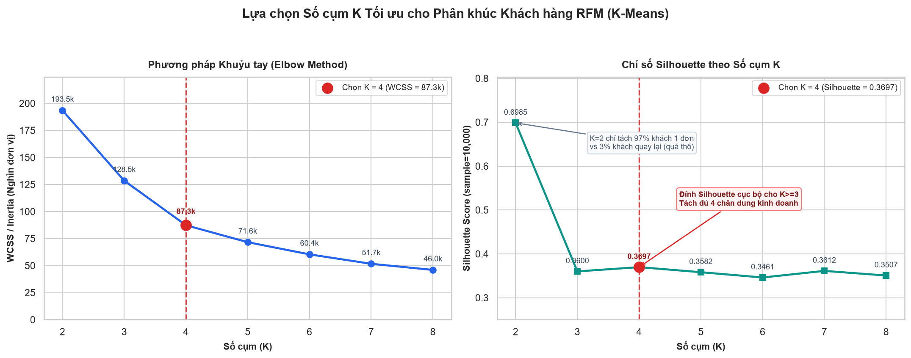
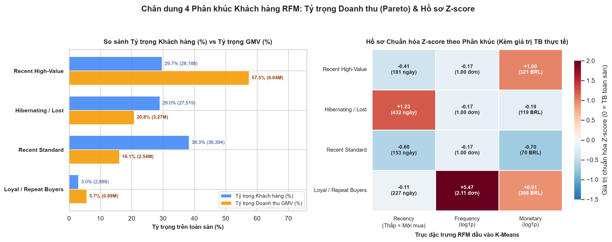

# Báo cáo Phân cụm Khách hàng RFM & K-Means — Chương 6 (Chặng 1)

- **Thời điểm thực thi:** 2026-11-25 22:39:38
- **Mốc chốt dữ liệu (`snapshot_date`):** `2018-09-04` (`MAX(purchase_date) + 1 ngày`)
- **Quy mô tập khách hàng hợp lệ:** **94,989** khách hàng duy nhất (`customer_unique_id`, lọc `order_status NOT IN ('canceled', 'unavailable')` và `payment_total > 0`).

---

## 1. Bối cảnh Dữ liệu RFM & Chiến lược Tiền xử lý

- **Đặc thù cực đoan của sàn Olist:** Có tới **92,101 khách hàng (96.96%)** chỉ mua đúng **1 đơn hàng**, và chỉ **2,888 khách hàng (3.04%)** mua lặp lại từ 2 đơn trở lên.
- **Kiểm tra độ lệch (Skewness) trước khi phân cụm:**
  - `recency_days`: Skewness = **0.45** (gần đối xứng $\rightarrow$ giữ nguyên tuyến tính để bảo toàn khoảng cách theo thời gian).
  - `frequency`: Skewness = **11.51** (lệch phải cực mạnh $\rightarrow$ biến đổi `np.log1p(frequency)`).
  - `monetary`: Skewness = **9.11** (lệch phải rất mạnh $\rightarrow$ biến đổi `np.log1p(monetary)` để giảm sức kéo của các đơn hàng nghìn BRL).
- **Chuẩn hóa bắt buộc:** Cả 3 biến đầu vào (`recency_days`, `log1p_frequency`, `log1p_monetary`) được đưa về cùng thang đo (mean = 0, std = 1) bằng `StandardScaler` trước khi tính khoảng cách Euclidean trong K-Means.

---

## 2. Quá trình Lựa chọn Số cụm $K$ Tối ưu

Thực hiện quét $K \in \{2..8\}$ với `init='k-means++'`, `n_init=10`, `random_state=42` và tính `silhouette_score` trên mẫu ngẫu nhiên `sample_size=10,000` để tránh tràn RAM ($N^2 \approx 9 \times 10^9$ cặp khoảng cách):

| Số cụm ($K$) | Inertia (WCSS) | Silhouette Score | Đánh giá lựa chọn |
| :---: | ---: | ---: | :--- |
| 2 | 193,509.1 | 0.6985 | Cực đại kỹ thuật nhưng quá thô (chỉ tách 97% mua 1 lần vs 3% quay lại) |
| 3 | 128,532.9 | 0.3600 | Giảm độ tách biệt cụm hoặc chia nhỏ dư thừa |
| **4** | **87,330.3** | **0.3697** | **ĐƯỢC CHỌN — Điểm gập Elbow rõ & Đỉnh Silhouette cao nhất trong nhóm $K \ge 3$** |
| 5 | 71,641.5 | 0.3582 | Giảm độ tách biệt cụm hoặc chia nhỏ dư thừa |
| 6 | 60,393.7 | 0.3461 | Giảm độ tách biệt cụm hoặc chia nhỏ dư thừa |
| 7 | 51,667.5 | 0.3612 | Giảm độ tách biệt cụm hoặc chia nhỏ dư thừa |
| 8 | 46,001.6 | 0.3507 | Giảm độ tách biệt cụm hoặc chia nhỏ dư thừa |

**Lý do chọn $K = 4$:** Tại $K = 4$, đường cong Inertia thể hiện điểm gập (*elbow*) rõ rệt (giảm mạnh từ `193.5k` xuống `87.3k` rồi chững lại), đồng thời **Silhouette Score đạt đỉnh cục bộ `0.3697`** (cao hơn mọi $K \in \{3, 5, 6, 7, 8\}$) và phân tách sạch sẽ 4 nhóm chân dung kinh doanh có hành động riêng biệt.

---

## 3. Chân dung Chi tiết 4 Phân khúc Khách hàng

| Phân khúc (`segment_name`) | Số khách | % Khách | Tổng GMV (BRL) | % GMV | Recency TB / Med (Ngày) | Freq TB / Med | Monetary TB / Med (BRL) | Tỷ lệ trễ (%) | Review TB |
| :--- | ---: | ---: | ---: | ---: | ---: | ---: | ---: | ---: | ---: |
| **Recent High-Value** | 28,188 | 29.68% | 9,044,507.91 | **57.47%** | 181.5 / 177 | 1.00 / 1 | 320.86 / 212.39 | 9.97% | 3.99 |
| **Hibernating / Lost** | 27,519 | 28.97% | 3,268,081.97 | **20.76%** | 431.8 / 424 | 1.00 / 1 | 118.76 / 97.72 | 4.88% | 4.17 |
| **Recent Standard** | 36,394 | 38.31% | 2,536,013.01 | **16.11%** | 152.7 / 152 | 1.00 / 1 | 69.68 / 66.59 | 8.93% | 4.16 |
| **Loyal / Repeat Buyers** | 2,888 | 3.04% | 890,534.12 | **5.66%** | 227.4 / 206 | 2.11 / 2 | 308.36 / 225.53 | 6.93% | 4.16 |

**Điểm nhấn Pareto rút ra từ dữ liệu:**
- Nhóm **`Recent High-Value`** chỉ chiếm **29.68%** tổng khách hàng nhưng đóng góp tới **57.47% tổng doanh thu GMV** (chi tiêu TB `320.86 BRL`, gấp ~4.6 lần nhóm `Recent Standard`).
- Nhóm **`Loyal / Repeat Buyers`** tuy chỉ chiếm **3.04%** (2,888 khách) nhưng đóng góp **5.66%** GMV (hiệu suất doanh thu/khách gấp gần 2 lần trung bình sàn) và có điểm review cao nhất (**4.16/5**).

---

## 4. Chiến lược Hành động Kinh doanh theo Phân khúc (Prescriptive Playbook)

| Phân khúc | Mục tiêu chiến lược | Kênh tiếp cận | Ưu tiên ngân sách | Hành động cụ thể đề xuất |
| :--- | :--- | :--- | :--- | :--- |
| **Recent High-Value** | Chuyển đổi khách mua 1 lần giá trị cao thành khách quay lại (đòn bẩy GMV số 1) | Email automation sau 14–30 ngày, Retargeting có chọn lọc | Ưu tiên số 1 (Chiếm ~57.6% tổng GMV toàn sàn) | Chuyển đổi thành khách trung thành: gửi voucher cá nhân hóa cho đơn kế tiếp trong cửa sổ 30–45 ngày, gợi ý cross-sell/upsell phụ kiện đi kèm và cam kết giao đúng hẹn. |
| **Hibernating / Lost** | Khơi lại nhu cầu với chi phí cận biên gần như bằng 0 | Chiến dịch Email Win-back tự động dịp lễ/Black Friday | Thấp (Không chi ngân sách Paid Ads cho nhóm rời bỏ > 1 năm) | Tái kích hoạt tự động chi phí thấp (Win-back): chỉ gửi email/push ưu đãi theo các dịp lớn (Black Friday, lễ hội), tránh đốt ngân sách quảng cáo trả phí trên nhóm đã ngủ đông lâu. |
| **Recent Standard** | Tăng giá trị giỏ hàng (AOV) & kích hoạt đơn hàng thứ 2 | Email tự động gợi ý combo, thông báo khuyến mãi trong ứng dụng | Trung bình (Tối ưu chi phí chuyển đổi qua tự động hóa) | Kích hoạt mua lần 2 & nâng giỏ hàng (AOV): đề xuất combo/freeship theo ngưỡng chi tiêu, email nhắc nhở ngành hàng tiêu dùng lặp lại (như health_beauty, housewares). |
| **Loyal / Repeat Buyers** | Bảo vệ nhóm khách trung thành cốt lõi & tăng tần suất mua lặp lại | Email VIP, Zalo/App Push cá nhân hóa, CSKH ưu tiên | Cao trên mỗi khách (Quy mô nhỏ 3.0%, ROI giữ chân cao nhất) | Chăm sóc VIP & giữ chân ưu tiên: chương trình tích điểm thành viên, ưu tiên SLA giao hàng nhanh, ưu đãi sinh nhật và giới thiệu sản phẩm mới sớm. |
