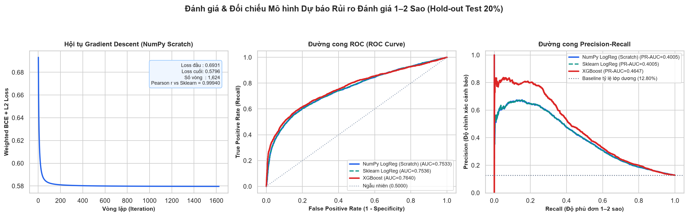
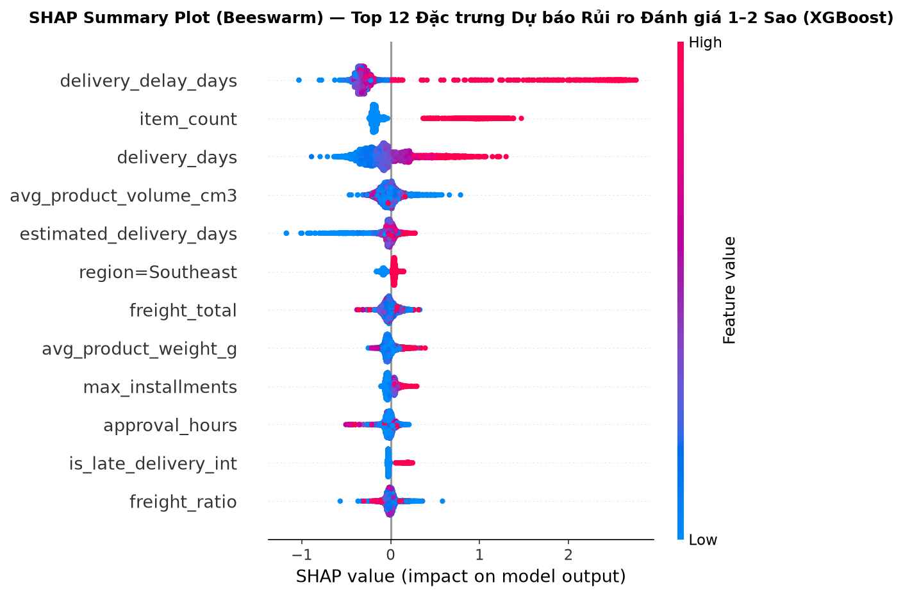
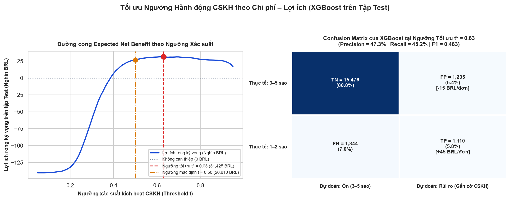

# Báo cáo Mô hình Dự báo Rủi ro Đánh giá Thấp, SHAP & Tối ưu Cost-Benefit — Chương 6 (Chặng 2)

- **Thời điểm thực thi:** 2026-11-25 23:15:09
- **Tập dữ liệu có nhãn (`is_valid_delivered = TRUE` & có review):** **95,824** đơn hàng, trong đó **12,272** đơn 1–2 sao (**12.81%** — bài toán phân lớp mất cân bằng).
- **Bối cảnh thời điểm chấm điểm & Chống rò rỉ dữ liệu (Zero Data Leakage):**
  - Mô hình được kích hoạt **ngay thời điểm đơn hàng vừa giao thành công tới tay khách (trước khi khách gửi đánh giá)** nhằm giúp đội CSKH chủ động gọi điện / tặng voucher xin lỗi các đơn nguy cơ cao.
  - **Tuyệt đối không đưa bất kỳ biến review nào** vào ma trận đặc trưng `X`. Toàn bộ bước chọn Top 10 ngành hàng, điền khuyết (`SimpleImputer`), chuẩn hóa (`StandardScaler`) và mã hóa (`OneHotEncoder`) đều chỉ `fit` bên trong từng `train_fold` và tập `Train (80%)`.

---

## 1. Kiểm chứng Toán học: Logistic Regression Thuần NumPy vs `scikit-learn`

Mô hình `NumpyLogisticRegression` tự cài đặt từ đầu bằng thuần NumPy (tối ưu hàm mất mát **Weighted Binary Cross-Entropy + L2 Regularization** bằng **Batch Gradient Descent**, không phạt hệ số chặn `b`) được đối chiếu trực tiếp với `sklearn.linear_model.LogisticRegression(class_weight='balanced')` trên tập Hold-out Test (20%):

- **Hệ số tương quan Pearson giữa xác suất dự đoán (`prob_numpy` vs `prob_sklearn`):** **`0.999400`** (yêu cầu `> 0.99` $\rightarrow$ **PASS**).
- **Độ lệch tuyệt đối `|ROC_AUC_numpy - ROC_AUC_sklearn|`:** **`0.000250`** (yêu cầu `< 0.005` $\rightarrow$ **PASS**).
- **Hội tụ Gradient Descent:** Loss giảm mượt từ `0.6931` xuống `0.5796` sau `1,624` vòng lặp.

---

## 2. Bảng So sánh Hiệu năng Toàn diện 3 Mô hình

### 2.1 Kết quả Stratified 5-Fold Cross-Validation trên Tập Train (Mean ± Std, ngưỡng 0.50)

| Mô hình | ROC-AUC | PR-AUC | Precision | Recall | F1-score |
| :--- | :---: | :---: | :---: | :---: | :---: |
| **NumPy LogReg (Scratch)** | 0.7473 ± 0.0073 | 0.4078 ± 0.0156 | 0.3507 ± 0.0084 | 0.5347 ± 0.0159 | 0.4236 ± 0.0109 |
| **Sklearn LogReg** | 0.7474 ± 0.0075 | 0.4075 ± 0.0157 | 0.3487 ± 0.0086 | 0.5345 ± 0.0169 | 0.4220 ± 0.0114 |
| **XGBoost** | 0.7572 ± 0.0079 | 0.4717 ± 0.0137 | 0.3757 ± 0.0119 | 0.5380 ± 0.0173 | 0.4424 ± 0.0138 |

### 2.2 Kết quả trên Tập Hold-out Test (20%, ngưỡng 0.50)

| Mô hình | ROC-AUC | PR-AUC | Precision | Recall | F1-score |
| :--- | :---: | :---: | :---: | :---: | :---: |
| **NumPy LogReg (Scratch)** | **0.7533** | **0.4005** | 0.3549 | 0.5440 | 0.4295 |
| **Sklearn LogReg** | **0.7536** | **0.4005** | 0.3540 | 0.5448 | 0.4291 |
| **XGBoost** | **0.7640** | **0.4647** | 0.3754 | 0.5412 | 0.4433 |

- **Nhận xét:** `XGBoost` vượt trội rõ rệt so với mô hình tuyến tính trên cả **ROC-AUC** và **PR-AUC** nhờ nắm bắt được quan hệ phi tuyến bậc thang của độ trễ giao hàng và các tương tác giữa số lượng sản phẩm (`item_count`), tỷ lệ phí vận chuyển (`freight_ratio`) và khối lượng kiện hàng.

---

## 3. Giải thích Mô hình Hộp xám bằng SHAP (`TreeExplainer`)

Bảng Top 10 đặc trưng có ảnh hưởng trung bình mạnh nhất (`mean(|SHAP value|)`) trên mẫu `5,000` đơn hàng từ tập Test:

| Hạng | Đặc trưng (`feature`) | Mean Abs SHAP | Vai trò nghiệp vụ |
| ---: | :--- | ---: | :--- |
| 1 | `delivery_delay_days` | **0.4138** | Độ trễ so với ngày hẹn (dương = giao trễ -> đẩy mạnh xác suất 1–2 sao) |
| 2 | `item_count` | **0.2597** | Số món hàng trong đơn (đơn nhiều món dễ giao thiếu/tách kiện) |
| 3 | `delivery_days` | **0.2229** | Tổng số ngày vận chuyển thực tế từ lúc đặt đơn |
| 4 | `avg_product_volume_cm3` | **0.0801** | Thể tích kiện hàng trung bình |
| 5 | `estimated_delivery_days` | **0.0567** | Khoảng thời gian cam kết giao hàng ban đầu |
| 6 | `region=Southeast` | **0.0546** | Khu vực địa lý nhận hàng của khách |
| 7 | `freight_total` | **0.0524** | Tổng phí vận chuyển khách phải trả |
| 8 | `avg_product_weight_g` | **0.0491** | Khối lượng trung bình sản phẩm (hàng nặng dễ hư hỏng/trễ) |
| 9 | `max_installments` | **0.0422** | Số kỳ trả góp tối đa của đơn hàng |
| 10 | `approval_hours` | **0.0398** | Thời gian chờ duyệt thanh toán (giờ) |

- **Đối chiếu nhất quán với Chương 5:** Kết quả SHAP khẳng định hoàn toàn độc lập bằng chứng kiểm định ANOVA & Chi-square ở Chương 5 — nhóm đặc trưng tiến độ giao hàng (`delivery_delay_days`, `delivery_days`, `is_late_delivery`) và cấu trúc kiện hàng (`item_count`, `freight_ratio`) đứng đầu bảng giải thích rủi ro đánh giá xấu!

---

## 4. Tối ưu Ngưỡng Hành động theo Chi phí – Lợi ích (Cost-Benefit Analysis)

**Bộ tham số kinh tế minh bạch cho chiến dịch CSKH chủ động:**
- Chi phí can thiệp chủ động mỗi đơn bị gắn cờ (`intervention_cost`): **`15.00 BRL`** (cuộc gọi CSKH + voucher xin lỗi).
- Tổn thất uy tín / mất LTV khi xảy ra đánh giá 1–2 sao (`churn_loss`): **`150.00 BRL`** (tham chiếu sát AOV ~160 BRL).
- Tỷ lệ xoa dịu/giữ chân thành công khi can thiệp đúng đơn rủi ro (`save_rate`): **`40%`** $\rightarrow$ Lợi ích ròng mỗi `TP` = **`+45.00 BRL`**, chi phí mỗi `FP` = **`-15.00 BRL`**.

| Kịch bản vận hành | Ngưỡng xác suất (`t`) | Số đơn gắn cờ (Test) | Precision | Recall | F1-score | Lợi ích ròng Tập Test (BRL) | Quy đổi Toàn sàn (~96.5k đơn) |
| :--- | :---: | ---: | :---: | :---: | :---: | ---: | ---: |
| Không can thiệp | - | 0 (0.0%) | - | 0.00% | - | 0.00 | 0.00 BRL |
| Ngưỡng mặc định | `0.50` | 3,538 (18.5%) | 37.5% | 54.1% | 0.443 | 26,610.00 | 133,947 BRL |
| **Ngưỡng tối ưu Cost-Benefit** | **`0.63`** | **2,345 (12.2%)** | **47.3%** | **45.2%** | **0.463** | **31,425.00** | **158,184 BRL** |

- **Insight cốt lõi:** Vì mô hình huấn luyện với `scale_pos_weight` đẩy mặt bằng xác suất dự đoán lên cao để ưu tiên Recall, nếu dùng máy móc ngưỡng mặc định `0.50` sẽ gắn cờ quá nhiều đơn nhầm (`FP = 2,210`), làm hao hụt ngân sách CSKH. Nâng ngưỡng lên **`t* = 0.63`** giúp tăng thêm **`+4,815.00 BRL`** lợi ích ròng ngay trên tập Test (tương đương **`+24,237 BRL`** trên quy mô toàn sàn).

---

## 5. Kết nối Phân khúc RFM (Chặng 1) & Bảng Điểm Rủi ro cho Power BI

Đã chấm điểm toàn bộ **96,470** đơn giao thành công hợp lệ vào bảng `dw.ml_order_risk_scores` (`High Risk`: **11,891** đơn | `Medium Risk`: **10,856** đơn | `Low Risk`: **73,723** đơn):
- **Ma trận Ưu tiên Hành động Kép (RFM × Risk Score) cho Chương 8:**
  1. **Ưu tiên P1 (`High Risk` + phân khúc `Recent High-Value` / `Loyal`):** Gọi điện trực tiếp xin lỗi ngay khi giao hàng + tặng voucher giá trị cao để bảo vệ nhóm mang lại 63% GMV toàn sàn.
  2. **Ưu tiên P2 (`High Risk` + phân khúc `Recent Standard`):** Gửi tin nhắn/email xin lỗi tự động kèm mã freeship đơn sau để tiết kiệm chi phí nhân sự tổng đài.
  3. **Theo dõi (`Medium Risk`):** Gửi khảo sát trải nghiệm nội bộ trước khi hệ thống gửi email xin đánh giá công khai trên sàn.
