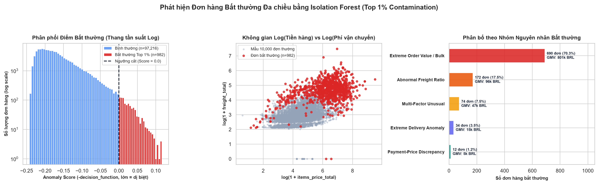

# Báo cáo Phát hiện Đơn hàng Bất thường bằng Isolation Forest — Chương 7 (Chặng 2)

- **Thời điểm thực thi:** 2026-11-26 19:59:30
- **Tổng số đơn hàng hợp lệ kiểm tra:** **98,198** đơn (`order_status NOT IN ('canceled', 'unavailable')`, `payment_total > 0`, `items_price_total > 0`).
- **Cấu hình mô hình:** `IsolationForest(n_estimators=200, contamination=0.01, random_state=42)` trên không gian **11 đặc trưng đa chiều** đã biến đổi `log1p` và chuẩn hóa bền vững bằng `RobustScaler`.
- **Lý do chọn `contamination = 1%` (982 đơn):** Khớp đúng năng lực rà soát thực tế của bộ phận Kiểm soát Vận hành & Gian lận (~1–2 đơn/ngày), tập trung vào các giao dịch thực sự cực đoan thay vì báo động giả tràn lan.

---

## 1. Đối chiếu Chân dung Thống kê: Đơn Bình thường (99%) vs Đơn Bất thường (1%)

| Chỉ số đo lường | Đơn Bình thường (99%) | Đơn Bất thường (Top 1%) | Chênh lệch / Ý nghĩa nghiệp vụ |
| :--- | ---: | ---: | :--- |
| Số lượng đơn hàng | 97,216 | **982** | Tỷ lệ gắn cờ đúng 1.00% |
| Tổng GMV liên quan (BRL) | 14,774,584.41 | **963,637.54** | Nhóm 1% đơn chiếm tới **6.12%** tổng GMV! |
| Giá trị thanh toán TB — AOV (BRL) | 151.98 | **981.30** | Cao gấp **6.5 lần** đơn thường |
| Số món hàng trung bình (`item_count`) | 1.12 | **3.35** | Tập trung các đơn mua sỉ / tách nhiều kiện |
| Tỷ lệ Phí ship / Tiền hàng TB | 30.7% | **44.8%** | Nhiều đơn phí vận chuyển đắt gấp rưỡi tiền hàng |
| Thời gian giao hàng TB (Ngày) | 12.49 | **19.74** | Kéo dài gấp **1.6 lần** trung bình |
| Tỷ lệ giao trễ hẹn (%) | 7.86% | **18.43%** | Nguy cơ đứt gãy SLA vận chuyển rất cao |
| Điểm đánh giá trung bình (1–5 sao) | 4.12 | **3.26** | Thấp hơn **0.86 sao** — xác thực bất thường thực sự gây trải nghiệm xấu! |

---

## 2. Phân loại theo Nhóm Nguyên nhân Bất thường (`anomaly_type`)

Mỗi đơn trong nhóm 1% bất thường được tự động phân loại vào 5 kịch bản nghiệp vụ dựa trên các ngưỡng P99 (riêng sai lệch thanh toán áp sàn tối thiểu `9.9 BRL` để loại nhiễu làm tròn số thực):

| Nhóm nguyên nhân (`anomaly_type`) | Số đơn | Tỷ trọng (%) | Mức Critical | Tổng GMV (BRL) | AOV (BRL) | Số món TB | Giao TB (Ngày) | Tỷ lệ trễ (%) | Review TB |
| :--- | ---: | ---: | ---: | ---: | ---: | ---: | ---: | ---: | ---: |
| **Extreme Order Value / Bulk** | 690 | 70.3% | 92 | 801,026.40 | 1,160.91 | 3.95 | 16.6 | 12.6% | 3.32 |
| **Abnormal Freight Ratio** | 172 | 17.5% | 2 | 96,166.20 | 559.11 | 1.78 | 24.4 | 25.6% | 3.29 |
| **Multi-Factor Unusual** | 74 | 7.5% | 0 | 46,748.18 | 631.73 | 2.39 | 14.9 | 20.3% | 3.42 |
| **Extreme Delivery Anomaly** | 34 | 3.5% | 0 | 14,873.47 | 437.45 | 1.68 | 71.0 | 97.1% | 1.77 |
| **Payment-Price Discrepancy** | 12 | 1.2% | 5 | 4,823.29 | 401.94 | 2.33 | 17.4 | 16.7% | 2.92 |

---

## 3. Top 10 Đơn hàng Bất thường Nghiêm trọng nhất Cần Kiểm toán Ngay

| Hạng | Mã đơn (8 ký tự) | Bang | Tiền hàng (BRL) | Phí ship (BRL) | Thanh toán (BRL) | Số món | Giao (Ngày) | Review | Điểm dị biệt | Loại bất thường |
| ---: | :---: | :---: | ---: | ---: | ---: | ---: | ---: | :---: | ---: | :--- |
| 1 | `cf465948` | PB | 1,050.00 | 1,794.96 | 2,844.96 | 6 | 13.8 | 5 | **0.1165** | `Extreme Order Value / Bulk` |
| 2 | `71dab115` | BA | 1,361.89 | 626.64 | 1,988.55 | 11 | 39.0 | 3 | **0.1147** | `Extreme Order Value / Bulk` |
| 3 | `2455cbeb` | PR | 419.40 | 1,002.29 | 1,421.69 | 6 | 10.0 | 1 | **0.1130** | `Extreme Order Value / Bulk` |
| 4 | `cfed507a` | MA | 1,380.00 | 711.33 | 2,091.33 | 3 | 39.5 | 1 | **0.1125** | `Extreme Order Value / Bulk` |
| 5 | `53cbc02f` | SP | 1,995.00 | 281.10 | 2,276.10 | 5 | 33.7 | 1 | **0.1075** | `Extreme Order Value / Bulk` |
| 6 | `6e5fe736` | PR | 179.19 | 108.72 | 406.92 | 6 | 7.6 | 1 | **0.1057** | `Payment-Price Discrepancy` |
| 7 | `62073ec6` | RJ | 859.66 | 456.47 | 1,316.14 | 7 | 22.3 | 2 | **0.1038** | `Extreme Order Value / Bulk` |
| 8 | `a6a5d567` | SP | 899.80 | 347.56 | 1,247.36 | 2 | 66.7 | 1 | **0.1031** | `Extreme Order Value / Bulk` |
| 9 | `f60ce04f` | SP | 1,099.70 | 340.40 | 1,440.10 | 10 | 6.0 | 1 | **0.0997** | `Extreme Order Value / Bulk` |
| 10 | `9aec4e1a` | SP | 1,879.90 | 354.76 | 2,234.66 | 10 | 9.1 | 1 | **0.0975** | `Extreme Order Value / Bulk` |

---

## 4. Quy trình Khuyến nghị Xử lý cho Vận hành, CSKH & Kiểm soát Gian lận

1. **`Extreme Order Value / Bulk` (Đơn giá trị rất lớn hoặc mua sỉ nhiều món):** Kích hoạt xác minh thanh toán 2 lớp chống thẻ tín dụng giả mạo (*chargeback fraud*), đồng thời gán mã vận đơn ưu tiên có bảo hiểm hàng hóa vì một đơn lỗi ở nhóm này gây thiệt hại doanh thu gấp ~7–10 lần đơn thường.
2. **`Abnormal Freight Ratio` (Phí vận chuyển cao bất thường so với giá hàng):** Rà soát lỗi khai báo sai kích thước/trọng lượng sản phẩm (`dim_products`) của người bán làm công thức tính cước bưu cục bị đội giá.
3. **`Payment-Price Discrepancy` (Lệch giữa tổng tiền thanh toán và giá trị đơn):** Đối soát cổng thanh toán, lãi trả góp cộng thêm hoặc lỗi áp mã voucher nhiều lần.
4. **`Extreme Delivery Anomaly` (Ngâm đơn quá 46 ngày hoặc trễ trên 18 ngày):** Tự động mở ticket bồi hoàn/gửi hàng thay thế và phạt điểm chất lượng đối tác vận chuyển / nhà bán hàng.
