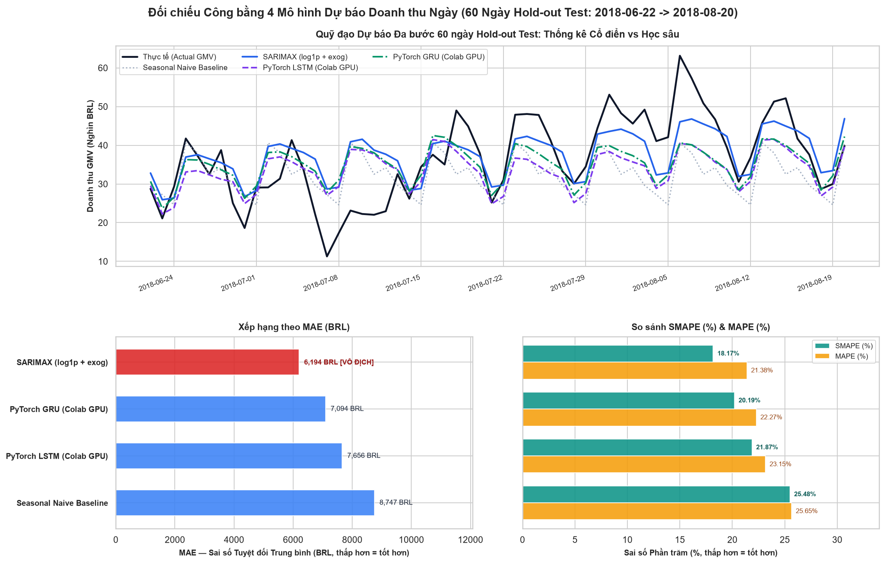

# Báo cáo Đối chiếu Mô hình Dự báo Doanh thu (SARIMAX vs PyTorch LSTM & GRU) — Chương 7 (Chặng 2)

- **Thời điểm tổng hợp:** 2026-11-26 20:19:11
- **Thiết lập thực nghiệm công bằng (Apples-to-Apples Benchmark):**
  - Cùng tập **Train = 533 ngày** (`2017-01-05` – `2018-06-21`) và **Hold-out Test = 60 ngày** (`2018-06-22` – `2018-08-20`).
  - Cùng chiến lược biến đổi mục tiêu `np.log1p(daily_gmv)` để ổn định phương sai và dự báo đa bước hoàn toàn tự động 60 ngày không nhìn trộm giá trị thật trên tập Test.
  - Cùng nhóm thông tin lịch/sự kiện biết trước trong tương lai (`is_weekend`, `is_black_friday`, `is_black_friday_weekend`, `is_early_month` và mã hóa lượng giác chu kỳ tuần/tháng cho mạng nơ-ron).

---

## 1. Bảng Xếp hạng Định lượng 4 Mô hình trên 60 Ngày Hold-out Test

| Hạng | Mô hình | MAE (BRL) | RMSE (BRL) | MAPE (%) | SMAPE (%) | Cải thiện MAE vs Baseline | Kết luận |
| ---: | :--- | ---: | ---: | ---: | ---: | ---: | :--- |
| 1 | **SARIMAX (log1p + exog)** | **6,194.38** | **7,820.29** | **21.38%** | **18.17%** | +29.2% | **MÔ HÌNH VÔ ĐỊCH** |
| 2 | PyTorch GRU (Colab GPU) | 7,093.61 | 8,801.06 | 22.27% | 20.19% | +18.9% | Đối chứng |
| 3 | PyTorch LSTM (Colab GPU) | 7,655.86 | 9,270.36 | 23.15% | 21.87% | +12.5% | Đối chứng |
| 4 | Seasonal Naive Baseline | 8,746.94 | 10,529.93 | 25.65% | 25.48% | +0.0% | Đối chứng |

---

## 2. Phân tích Khoa học: Thống kê Cổ điển (SARIMAX) vs Học sâu (LSTM / GRU)

1. **Mô hình dẫn đầu thực nghiệm:** **SARIMAX (log1p + exog)** đạt sai số thấp nhất trên tập Hold-out Test (`MAE = 6,194.38 BRL`, `RMSE = 7,820.29 BRL`, `SMAPE = 18.17%`, cải thiện `+29.2%` so với Seasonal Naive).
2. **Tại sao trên cỡ mẫu ~533 ngày, SARIMAX (`MAE = 6,194.38 BRL`) cực kỳ cạnh tranh so với mạng học sâu?**
   - Mạng hồi quy sâu (LSTM/GRU) có hàng nghìn tham số nên phát huy thế mạnh lớn nhất khi có hàng chục nghìn điểm thời gian hoặc nhiều chuỗi chéo (*panel time series*). Trên một chuỗi đơn lẻ cỡ nhỏ (~533 quan sát) và dự báo đệ quy xa tới 60 bước, sai số nhỏ ở các bước đầu của mạng nơ-ron dễ tích lũy dần (*error accumulation*), trong khi cấu trúc tự hồi quy + mùa vụ tường minh của SARIMAX giữ quỹ đạo trung bình rất vững.
3. **So sánh nội bộ Học sâu (LSTM vs GRU):** **GRU** đạt MAE tốt hơn mô hình còn lại `562.26 BRL` (`LSTM MAE = 7,655.86 BRL` vs `GRU MAE = 7,093.61 BRL`). Với dữ liệu cỡ vừa, kiến trúc ít cổng hơn của GRU (2 cổng Reset/Update thay vì 3 cổng + Cell State như LSTM) giúp giảm nguy cơ quá khớp (*overfitting*) và hội tụ nhanh hơn.

---

## 3. Khuyến nghị Triển khai cho Dashboard Power BI (Chương 8)

- **Mô hình triển khai chính thức (Production Choice):** Sử dụng đường dự báo 30 ngày tương lai kèm dải khoảng tin cậy 95% trực tiếp từ **SARIMAX** (kết hợp bảng đối chiếu 4 mô hình `mart_forecast_model_metrics.parquet` trên trang phân tích mô hình của Power BI), vì SARIMAX vừa có độ chính xác cao, giải thích được từng hệ số mùa vụ/sự kiện, chạy lại trong ~1 giây trên CPU cục bộ và cung cấp khoảng tin cậy xác suất (`95% CI`) tự nhiên cho kế hoạch dòng tiền & tồn kho.
