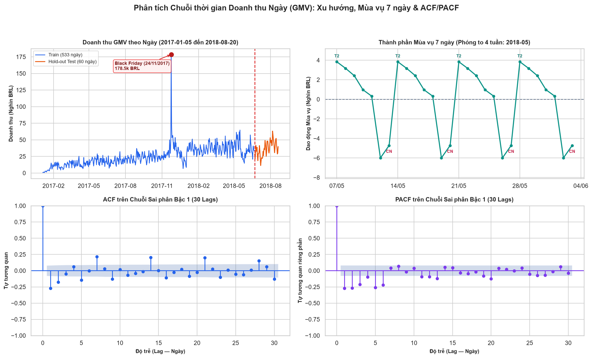
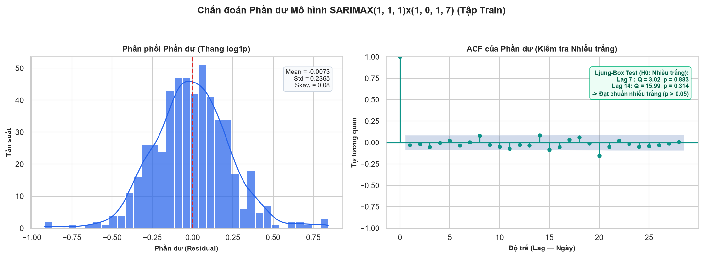
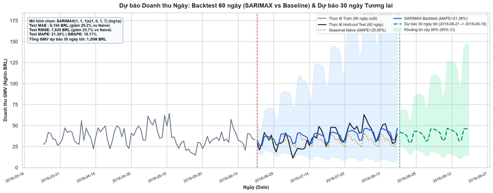

# Báo cáo Phân tích Chuỗi thời gian & Dự báo Doanh thu SARIMAX — Chương 7 (Chặng 1)

- **Thời điểm thực thi:** 2026-11-26 19:37:58
- **Phạm vi chuỗi ngày:** `2017-01-05` đến `2018-08-20` (**593 ngày liên tục**, phát hiện và nội suy 0 ngày trống).
- **Chia tập theo thời gian (Time-based Split):** Train = **533 ngày** (`2017-01-05` – `2018-06-21`), Hold-out Test = **60 ngày** (`2018-06-22` – `2018-08-20`).

---

## 1. Thiết kế Chuỗi thời gian, Xử lý Tháng biên & Biến ngoại sinh (`exog`)

- **Lý do chọn tần suất ngày (`freq='D'`, chu kỳ mùa vụ `s=7`):** Dữ liệu giao dịch E-commerce có nhịp điệu theo thứ trong tuần rất rõ (đầu tuần cao, cuối tuần thấp). Tần suất ngày cho độ dài gần 600 điểm — đủ lớn để ước lượng SARIMAX ổn định và huấn luyện mạng LSTM/GRU ở Chặng 2 (nếu gộp theo tháng chỉ có ~20 điểm quá ít cho học sâu).
- **Lý do chọn khung `2017-01-05` đến `2018-08-20`:** Loại bỏ giai đoạn thử nghiệm thưa thớt cuối năm 2016 / 4 ngày đầu 2017 và đoạn dữ liệu bị cắt đột ngột cuối tháng 08–10/2018 (*right-censoring*) khiến doanh thu tụt giả tạo về gần 0.
- **Bộ 4 biến ngoại sinh thuần lịch (không rò rỉ tương lai):**
  1. `is_weekend`: Cờ ngày Thứ 7 / Chủ nhật.
  2. `is_black_friday`: Cờ ngày sự kiện Black Friday `2017-11-24` (doanh thu vọt đỉnh kỷ lục).
  3. `is_black_friday_weekend`: Cờ 3 ngày hậu Black Friday (`2017-11-25` đến `2017-11-27`).
  4. `is_early_month`: Cờ giai đoạn đầu tháng từ ngày `1` đến ngày `10` (chu kỳ nhận lương phổ biến).

---

## 2. Phân rã Chuỗi & Kiểm định Tính dừng (ADF Test)

| Chuỗi kiểm định | Số quan sát | ADF Statistic | `p-value` | Ngưỡng 1% | Ngưỡng 5% | Ngưỡng 10% | Kết luận tính dừng |
| :--- | ---: | ---: | ---: | ---: | ---: | ---: | :--- |
| Chuỗi gốc (`daily_gmv`) | 577 | -2.9287 | `4.21e-02` | -3.4417 | -2.8666 | -2.5694 | **Dừng (Bác bỏ H0)** |
| Sai phân bậc 1 (`diff(1)`) | 572 | -8.1600 | `9.20e-13` | -3.4418 | -2.8666 | -2.5695 | **Dừng (Bác bỏ H0)** |
| Sai phân kết hợp mùa vụ (`diff(1).diff(7)`) | 568 | -10.7097 | `3.36e-19` | -3.4419 | -2.8666 | -2.5695 | **Dừng (Bác bỏ H0)** |

- **Diễn giải:** Chuỗi gốc `daily_gmv` có `p = 0.0421` (chỉ vừa qua ngưỡng 5% và không đạt dừng ở 1% do xu hướng tăng năm 2017). Sau khi lấy **sai phân bậc 1 (`d=1`)**, `ADF = -8.1600` (`p = 9.20e-13`), chuỗi đạt tính dừng cực mạnh; kết hợp sai phân mùa vụ đạt `ADF = -10.7097` (`p = 3.36e-19`).

---

## 3. Lựa chọn Tham số SARIMAX (AIC) & Kiểm định Phần dư Ljung-Box

**Lý do biến đổi `np.log1p(daily_gmv)`:** Doanh thu ngày của Olist có phương sai tăng theo quy mô và đỉnh nhọn Black Friday; biến đổi logarit ổn định phương sai tốt hơn hẳn thang gốc và đảm bảo dự báo chuyển ngược bằng `expm1` không bao giờ ra doanh thu âm.

| Cấu hình `(p,d,q)` | Mùa vụ `(P,D,Q,s)` | AIC (Train) | BIC (Train) | Test MAE (BRL) | Test RMSE (BRL) | Test MAPE (%) | Ghi chú |
| :---: | :---: | ---: | ---: | ---: | ---: | ---: | :--- |
| **`(1, 1, 1)`** | **`(1, 0, 1, 7)`** | **26.23** | 64.72 | 6,194.4 | 7,820.3 | 21.38% | **ĐƯỢC CHỌN (AIC thấp nhất)** |
| `(1, 1, 1)` | `(0, 1, 1, 7)` | 45.14 | 79.24 | 6,092.6 | 8,034.8 | 22.35% | Ứng viên đối chứng |
| `(2, 1, 1)` | `(0, 1, 1, 7)` | 46.38 | 84.75 | 6,041.2 | 7,955.3 | 22.10% | Ứng viên đối chứng |
| `(1, 1, 1)` | `(1, 1, 1, 7)` | 46.81 | 85.18 | 6,150.1 | 8,096.2 | 22.56% | Ứng viên đối chứng |
| `(2, 1, 2)` | `(1, 1, 1, 7)` | 47.43 | 94.33 | 5,946.7 | 7,758.2 | 21.54% | Ứng viên đối chứng |
| `(2, 1, 1)` | `(1, 1, 1, 7)` | 48.05 | 90.68 | 6,244.8 | 8,197.0 | 22.90% | Ứng viên đối chứng |
| `(1, 1, 2)` | `(1, 1, 1, 7)` | 49.17 | 91.81 | 6,014.1 | 7,883.0 | 21.92% | Ứng viên đối chứng |

**Kiểm định phần dư Ljung-Box trên tập Train (H0: Phần dư là nhiễu trắng độc lập):**
- Tại **Lag 7 (1 tuần):** $Q = 3.02$, **`p-value = 0.883`** ($> 0.05$ $\rightarrow$ Chưa đủ cơ sở bác bỏ H0).
- Tại **Lag 14 (2 tuần):** $Q = 15.99$, **`p-value = 0.314`** ($> 0.05$ $\rightarrow$ Phần dư đã tiệm cận **nhiễu trắng**, mô hình khai thác hết cấu trúc tự tương quan ngắn hạn và chu kỳ tuần).

---

## 4. Đánh giá Backtest 60 ngày & Dự báo Tương lai 30 ngày

- **Quy chuẩn Baseline (Seasonal Naive):** Lấy trung bình doanh thu theo từng thứ trong tuần của 4 tuần cuối tập Train để lặp lại cho 60 ngày Hold-out Test.

| Mô hình | MAE (BRL) | RMSE (BRL) | MAPE (%) | SMAPE (%) |
| :--- | ---: | ---: | ---: | ---: |
| Seasonal Naive Baseline (4-week DoW avg) | 8,746.94 | 10,529.93 | 25.65% | 25.48% |
| **SARIMAX(1, 1, 1)x(1, 0, 1, 7) (log1p + exog)** | **6,194.38** | **7,820.29** | **21.38%** | **18.17%** |
| *Mức cải thiện của SARIMAX so với Baseline* | **-29.2%** | **-25.7%** | **-16.6%** | **-28.7%** |

**Kết quả Dự báo 30 ngày tiếp theo (`2018-08-21` – `2018-09-19`):**
- **Tổng doanh thu GMV dự báo 30 ngày tới:** **`1,204,923.27 BRL`** (trung bình **`40,164.11 BRL/ngày`**).
- **Khoảng tin cậy 95% tổng 30 ngày:** từ `515,425.11 BRL` đến `2,935,841.91 BRL`.

---

## 5. Hạn chế của SARIMAX & Định hướng Đối chiếu với LSTM/GRU (Chặng 2)

1. **Giả định quan hệ tuyến tính trong cấu trúc AR/MA:** SARIMAX xử lý tốt tính mùa vụ 7 ngày và xu hướng ngắn hạn, nhưng gặp khó khăn nếu động lực doanh thu bị chi phối bởi các tương tác phi tuyến phức tạp hoặc chuỗi sự kiện nhiều bước trước đó.
2. **Độ trễ thích nghi khi chuyển chế độ (Regime Shift):** Khi doanh thu tăng trưởng nhanh trong năm 2017 rồi đi ngang trong nửa đầu 2018, thành phần trung bình trượt/sai phân bậc 1 đôi lúc phản ứng chậm ở các tuần giao mùa.
3. **Chuyển tiếp sang Chặng 2 (Google Colab GPU):** Đã xuất sẵn bộ dữ liệu đồng bộ 100% tại `data/processed/ts_daily_revenue_for_colab.csv` (cùng cột `split` khóa cứng 60 ngày cuối làm Test) để huấn luyện mô hình học sâu **LSTM / GRU** và so sánh công bằng trên cùng 4 độ đo MAE, RMSE, MAPE, SMAPE.
