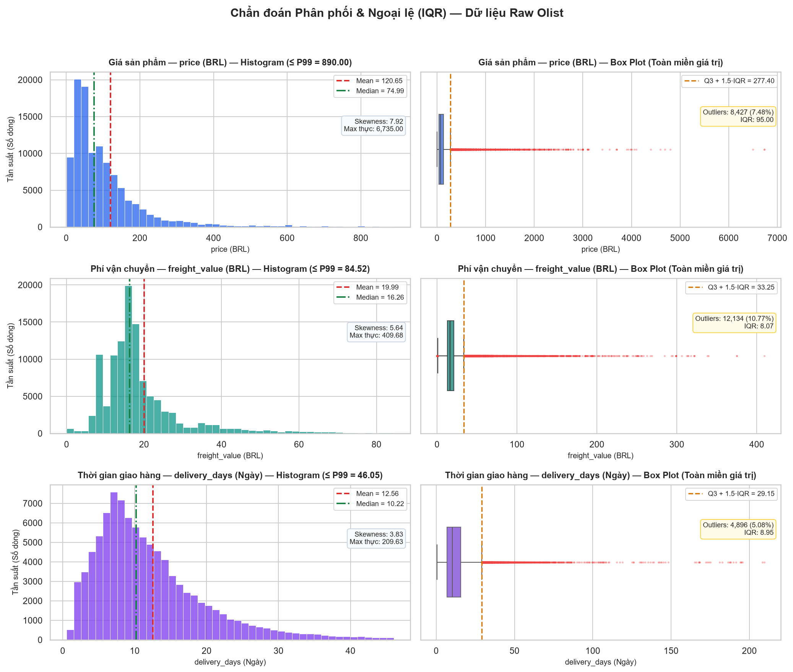

# Báo cáo Kiểm toán Chất lượng Dữ liệu — Tầng Raw (Olist DuckDB)

- **Thời điểm chạy kiểm toán:** 2026-11-23 23:52:46
- **Nguồn dữ liệu:** `olist.duckdb` (chế độ chỉ đọc `read_only=True`, tổng cộng 1,550,922 dòng trên 9 bảng `raw.*`)

---

## 1. Tính đầy đủ (Missing Values / Completeness)

Trong 9 bảng kiểm tra, có **6 bảng đầy đủ 100%** (không có `NULL` hay chuỗi rỗng): `raw.category_translation`, `raw.customers`, `raw.geolocation`, `raw.order_items`, `raw.order_payments`, `raw.sellers`.

| Bảng | Cột | Kiểu dữ liệu | Tổng dòng | Số dòng thiếu | Tỷ lệ thiếu (%) |
| :--- | :--- | :--- | ---: | ---: | ---: |
| `raw.order_reviews` | `review_comment_title` | `VARCHAR` | 99,224 | 87,658 | 88.34% |
| `raw.order_reviews` | `review_comment_message` | `VARCHAR` | 99,224 | 58,256 | 58.71% |
| `raw.orders` | `order_approved_at` | `TIMESTAMP` | 99,441 | 160 | 0.16% |
| `raw.orders` | `order_delivered_carrier_date` | `TIMESTAMP` | 99,441 | 1,783 | 1.79% |
| `raw.orders` | `order_delivered_customer_date` | `TIMESTAMP` | 99,441 | 2,965 | 2.98% |
| `raw.products` | `product_category_name` | `VARCHAR` | 32,951 | 610 | 1.85% |
| `raw.products` | `product_name_lenght` | `BIGINT` | 32,951 | 610 | 1.85% |
| `raw.products` | `product_description_lenght` | `BIGINT` | 32,951 | 610 | 1.85% |
| `raw.products` | `product_photos_qty` | `BIGINT` | 32,951 | 610 | 1.85% |
| `raw.products` | `product_weight_g` | `BIGINT` | 32,951 | 2 | 0.01% |
| `raw.products` | `product_length_cm` | `BIGINT` | 32,951 | 2 | 0.01% |
| `raw.products` | `product_height_cm` | `BIGINT` | 32,951 | 2 | 0.01% |
| `raw.products` | `product_width_cm` | `BIGINT` | 32,951 | 2 | 0.01% |

---

## 2. Tính duy nhất & Toàn vẹn tham chiếu (Duplicates & Integrity)

### 2.1 Kiểm tra trùng lặp khóa chính

| Bảng | Khóa chính kiểm tra | Tổng dòng | Số khóa duy nhất | Số dòng trùng |
| :--- | :--- | ---: | ---: | ---: |
| `raw.orders` | `order_id` | 99,441 | 99,441 | 0 |
| `raw.customers` | `customer_id` | 99,441 | 99,441 | 0 |
| `raw.products` | `product_id` | 32,951 | 32,951 | 0 |
| `raw.sellers` | `seller_id` | 3,095 | 3,095 | 0 |
| `raw.order_items` | `(order_id, order_item_id)` | 112,650 | 112,650 | 0 |

### 2.2 Đặc thù Olist & Toàn vẹn khóa ngoại (Orphan Keys)

| Hạng mục kiểm tra | Kết quả thực tế | Ý nghĩa / Diễn giải |
| :--- | ---: | :--- |
| `COUNT(DISTINCT customer_id)` vs `customer_unique_id` | 99,441 vs 96,096 | `customer_id` gắn theo từng đơn (1–1 với `orders`); có **2,997 khách thật** (3.12%) mua lặp lại ≥ 2 đơn |
| Trùng `order_id` trong `raw.order_reviews` | 551 dòng dư (547 đơn) | Có 547 đơn hàng nhận từ 2 đánh giá trở lên (trên tổng 99,224 dòng) |
| Trùng `geolocation_zip_code_prefix` trong `raw.geolocation` | 981,148 dòng dư | Chỉ có 19,015 mã zip duy nhất trên 1,000,163 tọa độ; **bắt buộc khử trùng trước khi JOIN** |
| `order_items.order_id` lạc loài (không có trong `orders`) | 0 | Toàn vẹn tham chiếu `order_items -> orders` đạt 100% |
| `orders.customer_id` lạc loài (không có trong `customers`) | 0 | Toàn vẹn tham chiếu `orders -> customers` đạt 100% |
| Sản phẩm có danh mục nhưng thiếu bản dịch tiếng Anh | 13 dòng (2 danh mục) | Thiếu bản dịch cho: `pc_gamer`, `portateis_cozinha_e_preparadores_de_alimentos` |

---

## 3. Tính nhất quán nghiệp vụ (Business Logic Consistency)

| Bảng | Quy tắc kiểm tra | Số dòng vi phạm | Tập đối chiếu | Tỷ lệ (%) |
| :--- | :--- | ---: | ---: | ---: |
| `raw.orders` | Đơn `delivered` nhưng thiếu `order_delivered_customer_date` | 8 | 96,478 | 0.008% |
| `raw.orders` | `order_delivered_customer_date < order_purchase_timestamp` | 0 | 96,476 | 0.000% |
| `raw.orders` | `order_approved_at < order_purchase_timestamp` | 0 | 99,281 | 0.000% |
| `raw.orders` | `order_delivered_carrier_date < order_approved_at` | 1,359 | 97,644 | 1.392% |
| `raw.orders` | `order_delivered_customer_date < order_delivered_carrier_date` | 23 | 96,475 | 0.024% |
| `raw.order_items` | `price <= 0` | 0 | 112,650 | 0.000% |
| `raw.order_items` | `freight_value < 0` | 0 | 112,650 | 0.000% |
| `raw.order_payments` | `payment_value <= 0` | 9 | 103,886 | 0.009% |
| `raw.order_payments` | `payment_installments < 1` | 2 | 103,886 | 0.002% |
| `raw.order_reviews` | `review_score` nằm ngoài khoảng 1..5 | 0 | 99,224 | 0.000% |

---

## 4. Đo lường phân phối & Phát hiện ngoại lệ (Distribution & IQR Outliers)

| Biến | Count | Min | Q1 | Median (Q2) | Mean | Q3 | Max | Std | IQR | Ngưỡng dưới | Ngưỡng trên | Outliers | Tỷ lệ (%) | Skewness | Excess Kurtosis |
| :--- | ---: | ---: | ---: | ---: | ---: | ---: | ---: | ---: | ---: | ---: | ---: | ---: | ---: | ---: | ---: |
| `price` | 112,650 | 0.85 | 39.90 | 74.99 | 120.65 | 134.90 | 6,735.00 | 183.63 | 95.00 | -102.60 | 277.40 | 8,427 | 7.48% | 7.92 | 120.83 |
| `freight_value` | 112,650 | 0.00 | 13.08 | 16.26 | 19.99 | 21.15 | 409.68 | 15.81 | 8.07 | 0.98 | 33.25 | 12,134 | 10.77% | 5.64 | 59.79 |
| `payment_value` | 103,886 | 0.00 | 56.79 | 100.00 | 154.10 | 171.84 | 13,664.08 | 217.49 | 115.05 | -115.78 | 344.41 | 7,981 | 7.68% | 9.25 | 241.83 |
| `product_weight_g` | 32,949 | 0.00 | 300.00 | 700.00 | 2,276.47 | 1,900.00 | 40,425.00 | 4,282.04 | 1,600.00 | -2,100.00 | 4,300.00 | 4,551 | 13.81% | 3.60 | 15.13 |
| `delivery_days` | 96,470 | 0.53 | 6.77 | 10.22 | 12.56 | 15.72 | 209.63 | 9.55 | 8.95 | -6.66 | 29.15 | 4,896 | 5.08% | 3.83 | 39.32 |

### Biểu đồ chẩn đoán phân phối & ngoại lệ

---

## 5. Quy tắc làm sạch đề xuất cho Chương 4 (Cleaning Rules)

1. **KHÔNG xóa mù quáng các outlier giá trị cao (`price`, `payment_value`, `freight_value`, `product_weight_g`):**
   - Các giá trị vượt ngưỡng `Q3 + 1.5*IQR` (như đơn hàng lên tới 6,735 BRL hoặc thanh toán 13,664.08 BRL) phản ánh **giao dịch thật** của hàng điện tử, nội thất hoặc đơn hàng số lượng lớn, không phải lỗi nhập liệu.
   - **Hành động:** Giữ nguyên toàn bộ để tính đúng GMV, doanh thu và RFM trong kho dữ liệu & Power BI; khi dùng thống kê mô tả thì ưu tiên báo cáo **Median + IQR** song song với Mean; khi huấn luyện mô hình ML (Chương 6–7) sẽ xử lý bằng biến đổi `log1p` hoặc cờ đánh dấu thay vì xóa bỏ.
2. **Xử lý và gắn cờ lỗi logic nghiệp vụ (`orders`, `order_payments`):**
   - **8 đơn `delivered` thiếu `order_delivered_customer_date`:** Giữ đơn trong bảng tổng hợp doanh thu nhưng **loại khỏi phép tính `delivery_days`** (tránh làm sai lệch chỉ số thời gian giao hàng).
   - **1,359 đơn có `order_delivered_carrier_date < order_approved_at` và 23 đơn `order_delivered_customer_date < order_delivered_carrier_date`:** Gắn cờ cảnh báo `has_timestamp_anomaly = TRUE` ở tầng sạch thay vì xóa đơn (vì đơn vẫn giao thành công, nguyên nhân thường do độ trễ đồng bộ log giữa cổng thanh toán và đơn vị vận chuyển).
   - **9 dòng `payment_value <= 0` (toàn bộ bằng 0) và 2 dòng `payment_installments < 1`:** Gắn cờ hoặc chuẩn hóa `payment_installments = 1` khi bằng 0 và loại dòng `payment_value = 0` khi phân tích giá trị thanh toán trung bình.
3. **Khử trùng lặp có chủ đích trước khi JOIN (`geolocation` & `order_reviews`):**
   - **`raw.geolocation` (1,000,163 dòng -> 19,015 zip):** Tổng hợp mỗi `geolocation_zip_code_prefix` thành 1 dòng duy nhất (lấy `MEDIAN(geolocation_lat)`, `MEDIAN(geolocation_lng)` và thành phố/bang phổ biến nhất) trước khi nối với `customers`/`sellers` để tránh bùng nổ dòng.
   - **`raw.order_reviews` (547 đơn có nhiều review):** Lấy bản ghi mới nhất theo `review_answer_timestamp` / `review_creation_date` (hoặc tổng hợp trung bình `review_score` theo `order_id`) để đảm bảo quan hệ 1–1 khi gắn vào Fact đơn hàng.
4. **Xử lý giá trị thiếu & bổ sung bản dịch thiếu (`products`, `order_reviews`):**
   - **610 sản phẩm thiếu `product_category_name`:** Gán nhãn `'unknown'` ở bảng Dimension sản phẩm; với **2 sản phẩm thiếu trọng lượng/kích thước**, điền bằng trung vị (`MEDIAN`) theo nhóm hoặc toàn bảng nếu cần tính cước/đặc trưng ML.
   - **2 danh mục chưa có bản dịch tiếng Anh (13 sản phẩm):** Bổ sung ánh xạ fallback trong SQL (`'pc_gamer' -> 'pc_gamer'`, `'portateis_cozinha_e_preparadores_de_alimentos' -> 'portable_kitchen_food_preparers'`).
   - **Chuẩn hóa tên cột sai chính tả:** Đổi `product_name_lenght` $\rightarrow$ `product_name_length` và `product_description_lenght` $\rightarrow$ `product_description_length` khi xây bảng Dimension ở Chương 4.
   - **Bình luận đánh giá (`review_comment_title`, `review_comment_message`):** Giữ nguyên `NULL` vì đây là trường tùy chọn của khách hàng, tỷ lệ bỏ trống phản ánh đúng hành vi thực tế (chỉ có thể tạo cờ boolean `has_comment`).
